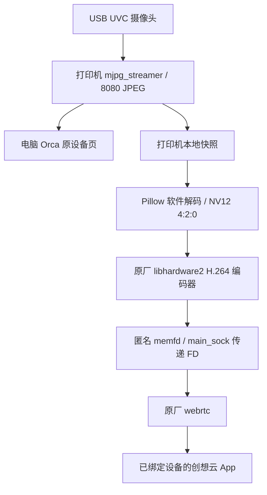

# 原理与云桥接

Orca 只是一个局域网视频客户端。摄像头采集、软件转换和云桥接均在打印机上执行，所以电脑关机后云视频仍可以工作。

## 为什么不直接运行 cam_app

原设备实测发现，`cam_app -c` 的厂商匹配分支未包含该普通 UVC 摄像头的厂商值。去掉检查进入后续流程仍存在 JPEG 末尾填充与 4:2:2 硬件解码兼容问题。仅上报 `online=1` 不会生成可播放画面。

本项目不运行补丁版 `cam_app`，不伪造厂商信息，不写账号配置。它读取已有原始 JPEG，经 Pillow 软件解码，转换到 NV12 4:2:0 与有限范围 YUV，再使用原厂 H.264 编码器。

## 原厂视频接口依赖

目前使用 `/dev/video1` 上的原厂编码器、已验证的 `libhardware2.so` ABI、1 MiB 双缓冲 memfd 布局和 `/var/run/main_sock` 的 FD 传递协议。尺寸固定 640×480，5fps，GOP 10，码率参数 768000bps。

`main_memfd` 是匿名内存对象的名称，不能通过普通目录中有没有同名文件来判断视频存在。诊断时看生产者进程的 `/proc/PID/fd`、ready 元数据及云桥接日志。

这些接口没有在本项目中被视为稳定公共 API。换固件、库或平台需要重新验证，不通过复制厂商二进制来强行兼容。

## 自启与守护

LAN 和云分别由 `S99e5m_uvc`、`S99e5m_cloud` 自启。云守护等待 LAN JPEG 和原厂云服务就绪后运行常驻引擎，检查可用内存和日志进度。它不会停止或重启 LAN 采集。

云引擎使用单实例锁；正常退出撤销自己的在线状态、关闭编码器和内存对象、删除自己的 socket 与 PID。守护终止时会结束自己的子进程；引擎还设置了父进程退出信号。

当前测试的是云桥接子进程退出后重试，不代表所有内核死锁、断电或系统级故障都能由守护处理。
